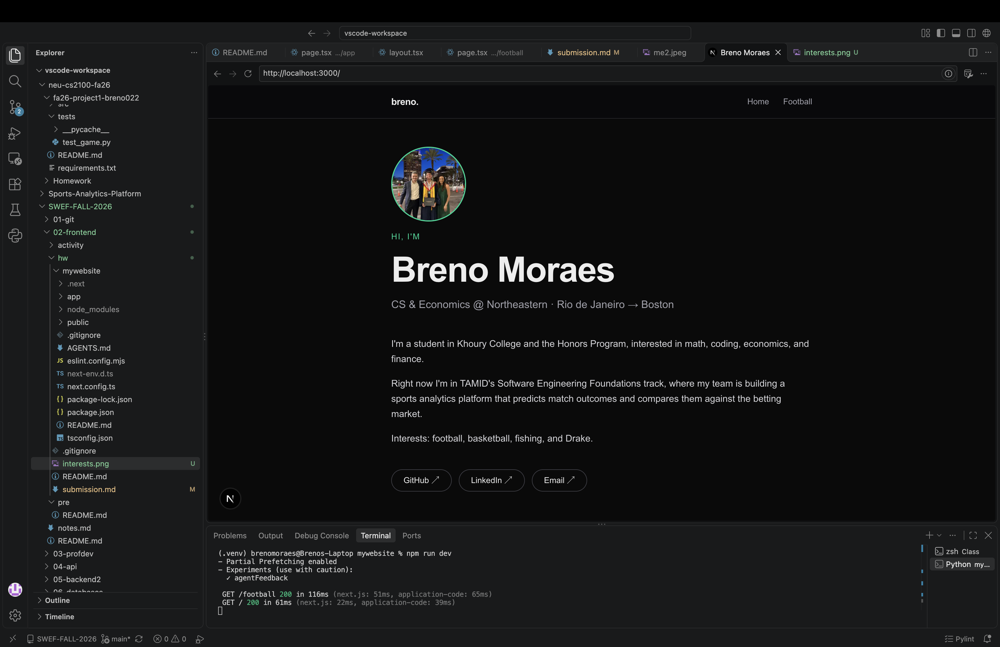
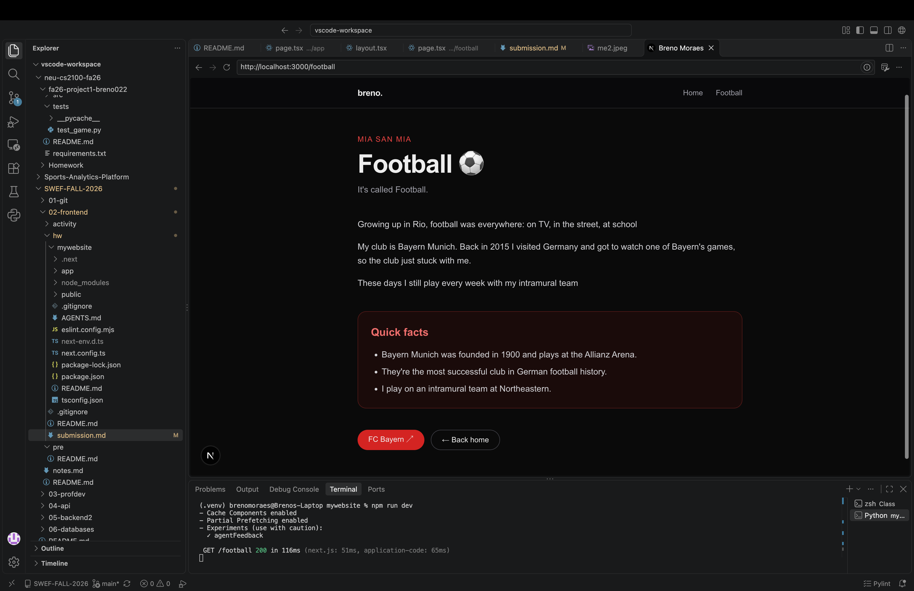

# Homework 2 submission

Fill this out (~200 words total across the writeup sections). See [README.md](README.md) for the full requirements.

## What I learned

How file-based routing works: `app/page.tsx` is `/`, and `app/football/page.tsx` is `/football`. 
I also learned that static files like images go in `public/` and are referenced from the root (`/me.jpeg`), 
and that filenames have to match exactly (`.jpg` vs `.jpeg` broke my profile picture until I caught it).

## Next.js vs raw HTML/CSS

With raw HTML I'd have to copy the navbar into every page. In Next.js it lives once in `layout.tsx` and wraps every route. 
Pages are also components, so I can store data (like my social links) in an array and `.map()` over it instead of repeating markup.

## How the tools fit together

React builds the UI out of components, TypeScript adds types so mistakes show up before running, 
Tailwind handles styling with utility classes right in the JSX, 
and Next.js ties it together with routing, layouts, and features like the `Image` component.

## My interest page

My page is about football. I grew up in Rio, I'm a Bayern Munich fan, and I play on an intramural team at Northeastern. 
It also connects to my TAMID project, where we're predicting match results.

## Screenshots

- Home: 
- Interest: 

## Project location

`02-frontend/hw/mywebsite`

## Optional: deploy link

<!-- Vercel URL if you deployed -->
